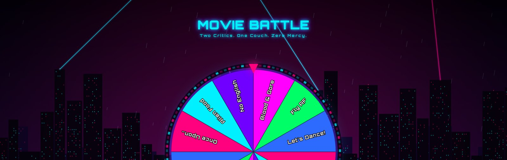
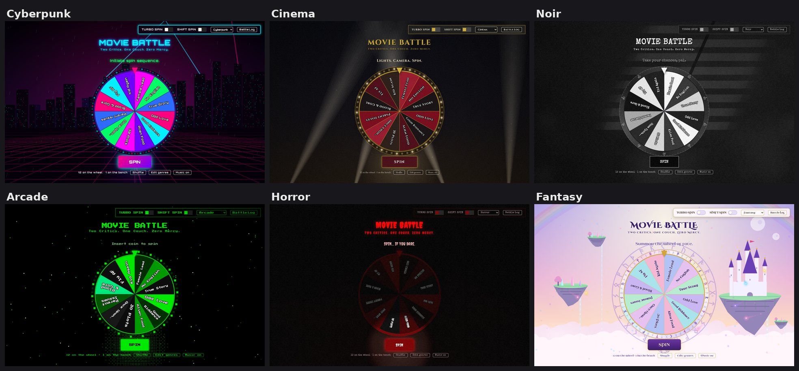
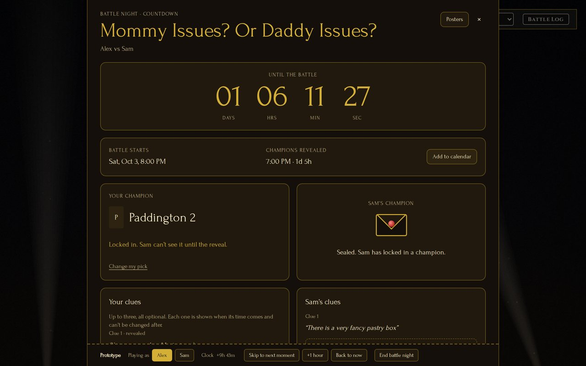
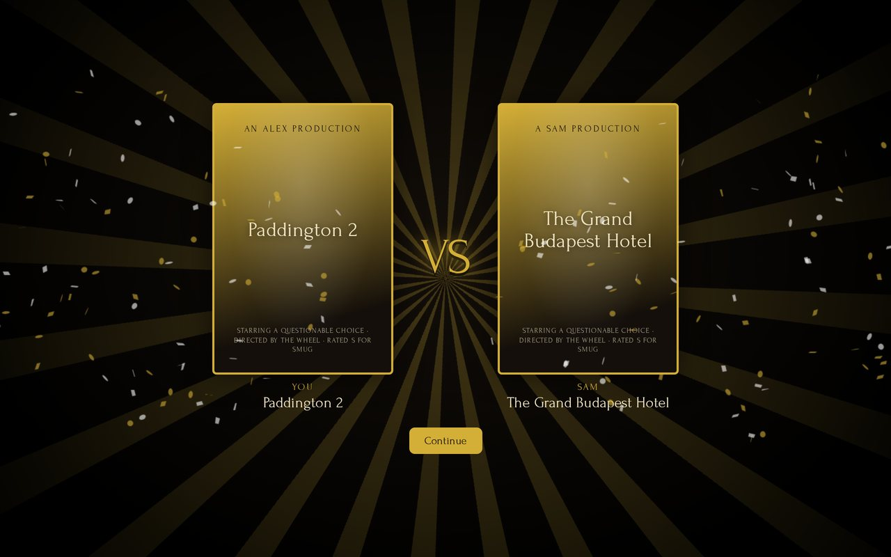
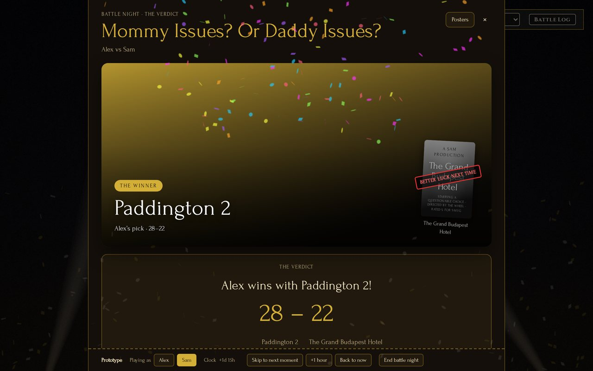
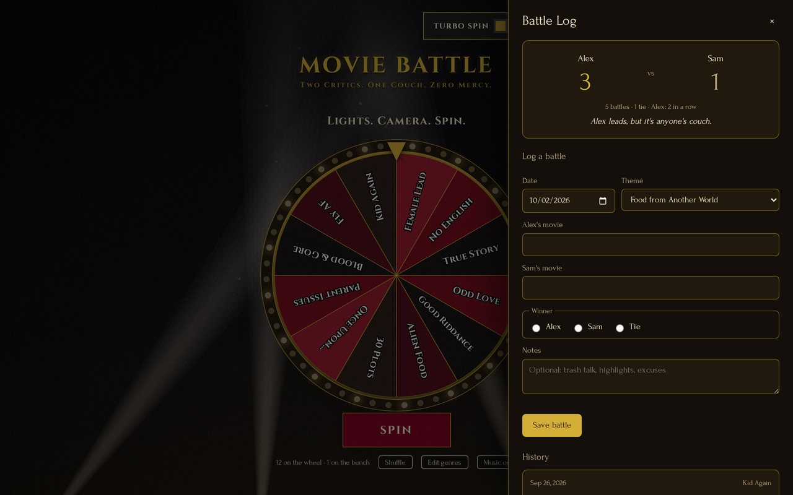
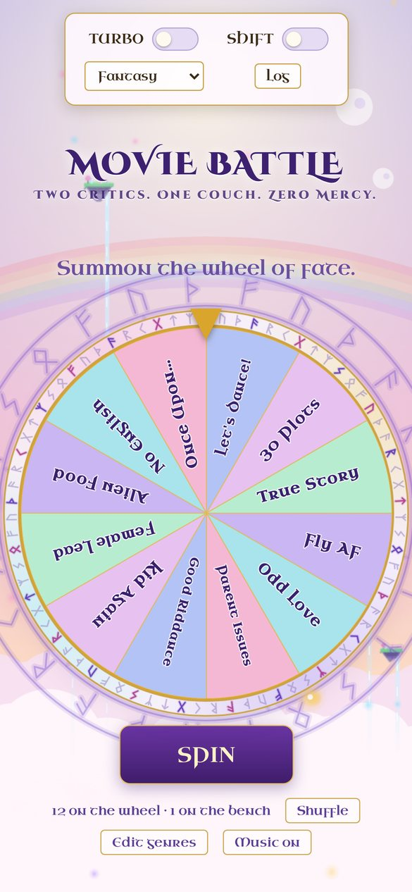

# Movie Battle

**Two Critics. One Couch. Zero Mercy.**

A themed spinning wheel for movie battle nights. Spin for a genre, each pick a
movie in secret, watch both back to back, and judge who wins. Every battle goes
on a running scoreboard.



## Contents

- [Background](#background)
- [How a battle works](#how-a-battle-works)
- [Opening the app](#opening-the-app)
- [Movie posters (TMDB)](#movie-posters-tmdb)
- [Customizing](#customizing)
- [Built with](#built-with)
- [Current status](#current-status)
- [What's next](#whats-next)
- [Challenges and decisions](#challenges-and-decisions)
- [Where things are](#where-things-are)
- [Third-party components](#third-party-components)
- [Copyright](#copyright)

## Background

Movie Battle started as a game between me and my partner. [How it began: for
example, a disagreement over whose taste in movies was better, or a way to make
picking a movie more fun.] The rules are simple:
pick a theme, each choose the movie that fits it best, watch both back to back,
and decide who wins.

The hard part was never the battle itself, it was getting started. Coming up
with a theme on the spot was difficult, and the genre ideas that came up along
the way kept getting lost. [Anything else that made it frustrating:
for example, the same themes coming up again and again, or neither of us
remembering who won last time.]

So I built a wheel to hold our list of custom genres and pick the theme for us.
It grew from there: a scoreboard so the bragging rights are on record, secret
picks and cryptic clues to build suspense, and a reveal worthy of the moment.
What started as a way to pick tonight's theme became a whole battle night.

## How a battle works

1. **Spin the wheel** for tonight's theme. Lock it in, or spin again.
2. **Pick a time** in Battle Night. One of you proposes, the other accepts.
3. **Choose your champions in secret.** Each of you locks in a movie for the
   theme, and can drop up to three cryptic clues that unlock during the countdown.
4. **The reveal.** An hour before the battle, both picks are revealed with a
   montage of stills from the two movies.
5. **Watch and judge.** Score both movies in secret. The verdict goes into the
   Battle Log, with the scoreboard and history.

| Battle Night: the countdown, sealed picks and clues | The reveal |
|---|---|
|  |  |
| **The verdict** | **The Battle Log** |
|  |  |



*On a phone. The screenshots use the app's stand-in posters; with a TMDB key,
real posters and movie stills appear instead.*

## Opening the app

Double-click **Open Movie Battle.command**. It starts a small local web server
and opens the app in your browser; close its Terminal window to stop it.

- **First time only,** macOS may block it as being from an unidentified
  developer. Allow it under **System Settings > Privacy & Security**
  ("Open Anyway"), or on older macOS right-click it and choose **Open**.
- It uses **Python 3**, part of Apple's free Command Line Tools (installed with
  Git). If they're missing, macOS offers to install them, or run
  `xcode-select --install`.
- **Without the opener,** run `python3 -m http.server 8123 --bind 127.0.0.1` in
  this folder, then open <http://localhost:8123>.

Double-clicking `index.html` shows a notice instead: browsers don't run
JavaScript modules on pages opened straight from a file.

## Movie posters (TMDB)

Posters, movie search, clue ideas and the reveal montage use
[TMDB](https://www.themoviedb.org), a free movie database. To turn them on:

1. Make a free TMDB account, then go to **Settings > API** and request a key
   for personal use.
2. In the app, open Battle Night, click **Posters**, and paste the key.

The key is saved only in that browser (never in the project files), so paste
it once on each device you use. Without a key, the app shows stand-in posters.

## Customizing

| To change | Where |
|---|---|
| Genres on the wheel | In the app: **Edit genres** under the wheel |
| The starting genre list and slice colours | `js/wheel/genres-and-colors.js` |
| A theme's prompt, font, music or win sound | `js/wheel/themes.js` |
| A theme's look | `css/theme-<name>.css` |
| A theme's animated background | `lighting/<name>.js` |
| Background music tracks | `audio/music/` (one per theme) |

## Built with

- **HTML, CSS and JavaScript modules**, with no framework, so the app is just
  files a browser can run directly
- **Canvas** for drawing the wheel and each theme's animated background
- **The Web Audio API** for music, sound effects and the reveal's timing
- **The TMDB API** for movie search, posters, stills and clue ideas
- **canvas-confetti** for the celebrations

## Current status

- **Each device keeps its own data** (Battle Log, genres, battle nights) until
  the shared version, planned with Firebase.
- **Battle Night is a prototype on one device.** The bar at the bottom switches
  between the two players and can skip ahead in time, for trying the whole flow.
  With the shared version, each phone becomes its own player and picks stay
  sealed until the reveal.

## What's next

1. **Hosting**, so the app has a real web address to open on any device.
2. **Shared data with Firebase**, so both players use their own phones with the
   same Battle Log and battle nights, and picks stay sealed on the server until
   the reveal.
3. **An installable version** that can be added to a phone's home screen and
   works offline.
4. **Messages and calendars**: battle invites sent through the phone's share
   menu, reminders, and battle nights in Apple Calendar.

## Challenges and decisions

Some of the problems I ran into while building this, how I solved them, and
why I chose one approach over another.

### Keeping the wheel fair

The wheel holds up to 12 genres, because past that the slices get too thin to
read on a phone. With more genres than that, the rest wait on a "bench," and a
random 12 are drawn. That stays fair: every genre has the same chance of making
the wheel, and then the same chance of being picked. An optional setting favors
genres that haven't been battled yet, but it only makes played ones less likely, never
impossible, so nothing is ever locked out.

### Fitting genre names into the slices

Labels were spilling over the edges of their slices. They were sized to fit
along each slice, but slices get narrower toward the center, and the labels
were never checked against that width. I measured it first: 7 to 9 labels per
screen size spilled, by up to 5.5 pixels. Now each label is checked against the
slice's real width at every point, using each font's actual letter shapes, with
a margin on both sides. Long names shrink, wrap onto more lines, or, as a last
resort, get shortened with "..." rather than spill.

### Keeping the picks secret

The whole game depends on neither of us seeing the other's movie early. Hiding
a pick on screen isn't enough on its own, since anyone determined could dig it
out of the browser. So the shared version is planned so that the server refuses
to send the other person's pick until the reveal time; it won't just be hidden,
it won't be there to find.

I also found a subtler leak: when the reveal began, the page drew both posters
underneath the reveal animation, which faded in over a fraction of a second, so
the picks could flash through. The reveal now covers the screen instantly, and
the page doesn't draw anything about the picks until the animation has played.

The same-movie check uses TMDB's exact movie IDs rather than titles, so *Heat*
(1995) and *Heat* (1986) count as different movies, and "matrix" and
"The Matrix" count as the same. It runs the moment both picks are locked in,
not at the reveal, so there's time to pick something else.

### The reveal

The reveal is a montage of 30 stills from the two movies, speeding up into the
moment the posters slam in. Getting it right meant solving several problems:

- **Flashing.** Fast, full-screen cuts between bright and dark images can
  trigger seizures in people with photosensitive epilepsy. Instead of slowing
  the montage down, I went after the cause: every still is measured and
  adjusted to a similar brightness before it's shown, each cut blends briefly
  into the next, the pace never goes beyond 8 cuts a second, and the montage is
  skipped entirely for anyone with reduced motion turned on.
- **Staying in time with the sound.** The posters have to land exactly on the
  sound's big impact. Timers drift, so the montage follows the sound's actual
  playback position instead.
- **A sound that was too short.** Opening on black, with a slow start and a fast
  finish, didn't fit in the time before the impact. Rather than cut images or
  speed up the ending, I slowed only the quiet opening of the sound, without
  changing its pitch, and left the build and the impact untouched.
- **Only images from the movie.** Posters and promotional art are excluded by
  using only stills with no text on them.
- **A brief black box.** Large images sometimes flashed a dark block for a
  split second as the browser drew them. Every still is now fully loaded and
  decoded before its turn comes.

### Sound and music

The background tracks varied hugely in volume, from very quiet to very loud, so
switching themes felt like someone grabbing the volume knob. Each track was
adjusted to the same loudness. Some also had silence or fades at their ends,
which left a gap every time they looped; I trimmed those, and for two tracks
built proper crossfade loops at points where the beat lines up, so they repeat
seamlessly. Browsers also block sound until the page is clicked, so music starts
on the first click rather than trying to autoplay.

### Phones

The app is built once and adapts to the screen, rather than having a separate
phone version that would need every change made twice. Along the way: the
control panel became a tidy grid on phones, Battle Night stacks into one column,
and I fixed a bug where the spinning wheel's rotated outline made the page
scroll sideways after a spin.

### Saving and sharing

For now, everything is saved in the browser, so each device has its own data.
Export and Import move the Battle Log (and genres) between devices, and a
warning appears if a browser can't save at all. The shared version, planned with
Firebase, will let both of us use our own phones with the same data. Saving was
built behind a single layer from the start, so switching to shared storage
means replacing one piece rather than rewriting the app.

### Security

- **Nothing anyone types is ever treated as code.** Movie titles, notes, clues
  and imported backups always go onto the page as plain text.
- **No outside code or fonts.** The fonts and the confetti library are stored
  in the project instead of loaded from other servers, so nothing outside the
  project can change what runs, Google isn't contacted every time the app
  opens, and it all works offline.
- **A strict security policy** for the hosted site (`_headers`) lets the page
  load only its own files and TMDB. Removing all inline code from the page is
  what made such a strict policy possible.
- **The TMDB key stays out of the code.** It's saved only in each browser, so it
  can't end up on GitHub or in the hosted site.

### Organizing the code

The app started as one large file and grew into two that were over 750 and
1,250 lines long. I split them into small, clearly named JavaScript modules,
each declaring exactly what it shares, which cut the names shared across the
whole page from 60 to 3. The trade-off is that browsers won't run modules from
a page opened by double-clicking it, which is why the project includes
**Open Movie Battle.command**. The split was done with a code parser rather
than by hand, so names were changed only where they're actually code, never
inside text, and everything was retested afterward.

### Smaller choices

- **Undo instead of "Are you sure?" pop-ups.** Actions happen right away, with a
  few seconds to take them back. It's friendlier, and it protects against the
  easiest mistake to make.
- **Stand-in posters.** Posters need a TMDB key, so the app has stand-ins with
  fake credits for when there's no key, or a poster won't load. The reveal
  always has artwork.
- **One web app for every device.** Laptop, phone and TV all use the same
  website, and phones can add it to the home screen like an app. That gives an
  app-like experience without the costs and reviews of the app stores.

## Where things are

```
Open Movie Battle.command   double-click to open the app
index.html                  the page itself
_headers                    security settings for the hosted site

css/                        how everything looks
  layout.css                  page layout shared by every theme
  theme-*.css                 one file per theme (colours, fonts, effects)
  side-panels.css             the Battle Log and Genre Editor panels
  battle-night.css            the Battle Night page and the reveal
  messages.css                the short notes with Undo at the bottom
  welcome.css                 the first-visit walkthrough

js/                         how everything works
  main.js                     the one entry point; loads everything below
  core/                       shared helpers: saved-data, sounds, page-elements
  wheel/                      the wheel
    genres-and-colors.js        the starting genres and slice colours
    themes.js                   the six themes (fonts, music, win sounds, prompts)
    genre-pool.js               12 on the wheel, the rest on the bench
    spin.js, drawing.js, title-card.js, controls-and-startup.js
  features/                   Battle Log, Genre Editor, movie lookup (TMDB),
                              clue ideas, music, messages, welcome walkthrough
  battle-night/               scheduling, champions, clues, the reveal, the
                              verdict (page.js ties them together)

lighting/                   each theme's animated background
audio/                      win sounds, the reveal sound, music/ per theme
fonts/                      the theme fonts and their licences
libraries/                  the confetti library and its licence
screenshots/                the pictures in this README
```

## Third-party components

These files are included under their own licenses and are not covered by the
copyright notice below:

- **fonts/**: Orbitron, Cinzel, Cinzel Decorative, Forum, Press Start 2P,
  Creepster and Uncial Antiqua (SIL Open Font License 1.1), and Special Elite
  (Apache License 2.0). License texts: `fonts/LICENSES/`
- **libraries/confetti.browser.js**: canvas-confetti 1.6.0 (ISC License).
  License text: `libraries/canvas-confetti-LICENSE.txt`
- **Movie data and images** are provided by TMDB. This product uses the TMDB
  API but is not endorsed or certified by TMDB.

## Copyright

Copyright (c) 2026 Elizabeth Tong. All Rights Reserved.

This software and its accompanying files are proprietary and confidential.
Unauthorized copying, modification, distribution, or use of this code,
via any medium, is strictly prohibited without the express written
permission of the copyright holder.
